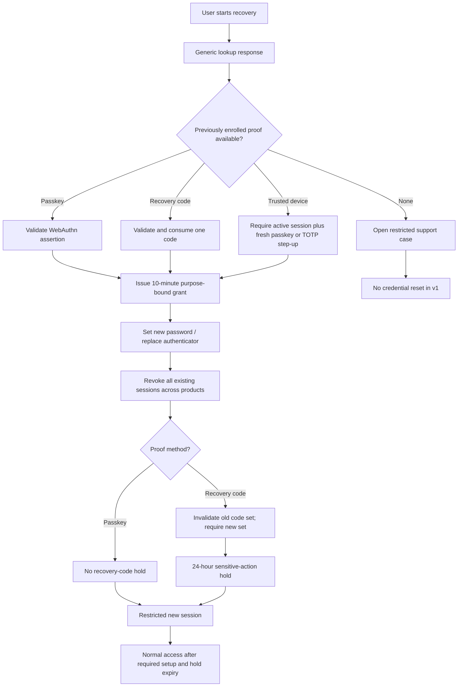

# InOne Identity — account recovery flow v0.1

**Status:** CTO-defined technical policy for v1; documentation only. No endpoint, schema, UI or recovery runtime is implemented.
**Branch:** `architecture/product-and-platform-blueprint-2026-11-13`

## 1. Security objective

Restore access only when the requester proves possession of a credential or recovery secret enrolled before the loss. Phone and email are mandatory registration data but remain unverified in the initial no-provider phase. They are lookup identifiers only, never recovery factors.

Fail closed when no enrolled authenticator or recovery code remains. Support must not bypass this rule using contact strings, account details, invitation tokens, device activation, an organization manager's assertion or marketplace/payment metadata.

## 2. Approved technical baseline

- Primary credential: password, stored only by Identity using Argon2id.
- Preferred phishing-resistant authenticator: WebAuthn passkey.
- Optional second authenticator: TOTP.
- Recovery set: 10 single-use codes, each with at least 128 bits of cryptographic randomness. Display once; store only keyed hashes; atomically consume; never allow reuse.
- Recovery grant: opaque, single-use, stored as a hash, bound to identity + client + device + purpose, 10-minute expiry.
- A password reset revokes every existing session/refresh-token family for the central identity across InOne, InOne Business and Propo.
- A recovery-code reset adds a 24-hour security hold on sensitive operations.
- Sensitive InOne Business financial permissions require an enrolled passkey or TOTP and a fresh recovery-code set. Recovery codes cannot approve financial actions.

## 3. Recovery decision tree

## 4. End-to-end sequence

1. **Start:** client sends a phone or email lookup identifier to `POST /v1/recovery/start`. Response body and status are generic and identical for known/unknown identifiers. Do not expose whether the contact exists or which authenticators are enrolled.
2. **Choose proof:** UI offers generic choices: use a passkey or enter a recovery code. A previously authenticated device may approve only after fresh passkey/TOTP step-up; an old session or unlocked app alone is not enough.
3. **Verify:** Identity validates WebAuthn assertion or recovery code, applies abuse/risk controls and atomically consumes a recovery code if used.
4. **Grant:** Identity issues a single-use, opaque, purpose-bound grant with 10-minute expiry, bound to the identity, client and current device. It cannot be exchanged for a normal access token.
5. **Reset:** client submits the grant and new password to `POST /v1/recovery/complete`. Identity atomically consumes the grant and stores the new Argon2id password hash.
6. **Contain:** revoke every existing refresh-token family/session across all product contexts. Preserve no old session. Create only a restricted session on the current recovery device.
7. **Recovery-code path:** invalidate all codes in the old set; require generation of a new set before restoring sensitive Business permissions; apply a 24-hour security hold.
8. **Passkey path:** no 24-hour hold is required when a fresh valid passkey assertion was used, but other sessions are still revoked after a password reset or authenticator replacement.
9. **Audit:** append security events for start, challenge result, grant issue/consume, credential change, session revocation, hold placement/release and denial. Never log passwords, raw codes, raw tokens or full contacts.

## 5. Lost-device scenarios

| Situation | Allowed action | Not allowed |
|---|---|---|
| User still has a working passkey | Authenticate with passkey; reset password or enroll replacement authenticator | Reset based only on phone/email |
| User lost primary device but has another enrolled passkey | Authenticate on another device; revoke lost device and sessions | Trust a device merely because it knows the account's phone/email |
| User has active session on another device and TOTP/passkey | Fresh step-up on that device; approve recovery | Session-only approval |
| User has no device but has unused recovery code | Use one code to obtain restricted recovery grant and reset credentials | Reuse code or use it to approve financial actions |
| User lost all devices and all authenticators but retained recovery code | Recover with one code; revoke all old sessions; 24-hour sensitive-action hold | Treat the code as contact verification |
| User lost every authenticator and every recovery code | Open support case; account remains blocked in v1 | Support/admin bypass or contact-only reset |

## 6. Contact replacement while unverified

- Require an authenticated session and fresh passkey/TOTP step-up.
- Atomically reserve the new normalized value as a pending change. Keep the old claim active for 72 hours.
- Revoke other sessions, preserve the initiating session and block sensitive actions while the change is pending.
- Permit cancellation only from the initiating trusted session with fresh step-up.
- At completion, activate the new claim and supersede/release the old claim in one audited transaction. If abandoned, expire the pending claim and preserve the old claim.
- Do not notify either unverified contact or treat either as proof of ownership. A value already claimed by another identity follows the separate manual contact-dispute process.
- If no passkey/TOTP is enrolled, self-service contact replacement is unavailable; do not create a password-only or contact-only bypass.

## 7. Manual support recovery boundary

Support may open and track a restricted case, but v1 does not permit a manual credential-reset override. A future override requires:

- independent identity proofing that does not rely on unverified phone/email or account trivia;
- documented evidence standards and privacy/legal review;
- a trained case operator plus an independent security approver;
- immutable evidence, decision and actor audit;
- a cooling period and notification through a newly verified channel.

If evidence is unavailable, contradictory or inconclusive, leave the account blocked. An InOne Business owner may reissue an invitation or change organization membership within delegated authority, but cannot recover central Identity or transfer the employee's personal/Propo data.

## 8. Security invariants

1. No unverified phone/email can reset a password, recover an authenticator, approve a financial operation or prove account ownership.
2. No recovery grant or recovery code can be used more than once.
3. Recovery grant is short-lived, purpose-bound and client/device-bound.
4. Password reset revokes all existing product sessions; product APIs continue their own authorization checks.
5. Recovery codes never substitute for passkey/TOTP step-up on sensitive financial actions.
6. Business administrators cannot reset central Identity credentials.
7. Manual support cannot override the fail-closed rule in v1.
8. All recovery state transitions are atomic, idempotent where retried and auditable.

## 9. Implementation checklist

- [ ] Add `recovery_codes`, `recovery_grants`, `recovery_cases` and `security_holds` persistence with appropriate unique indexes and retention policy.
- [ ] Implement generic recovery start and anti-enumeration behavior.
- [ ] Implement WebAuthn/passkey recovery and one-time recovery-code validation.
- [ ] Implement trusted-device approval with fresh step-up only.
- [ ] Implement single-use grant issuance/consumption and replay protection.
- [ ] Revoke all product sessions on password reset.
- [ ] Implement 24-hour sensitive-action hold and enforcement in InOne Business and other affected product APIs.
- [ ] Implement recovery-code generation, display-once UX, rotation and invalidation.
- [ ] Implement contact-change pending state, 72-hour cooling period and cancellation.
- [ ] Implement support case visibility without credential-reset override.
- [ ] Add rate limits, audit events, monitoring, threat model and adversarial tests.

**Related documents:**
- [IDENTITY-SERVICE-ARCHITECTURE-V0.1.md](IDENTITY-SERVICE-ARCHITECTURE-V0.1.md)
- [IDENTITY-API-AND-EVENT-CONTRACT-V0.1.md](IDENTITY-API-AND-EVENT-CONTRACT-V0.1.md)
- [IDENTITY-AND-PRODUCT-ACCOUNT-LIFECYCLE-V0.1.md](IDENTITY-AND-PRODUCT-ACCOUNT-LIFECYCLE-V0.1.md)