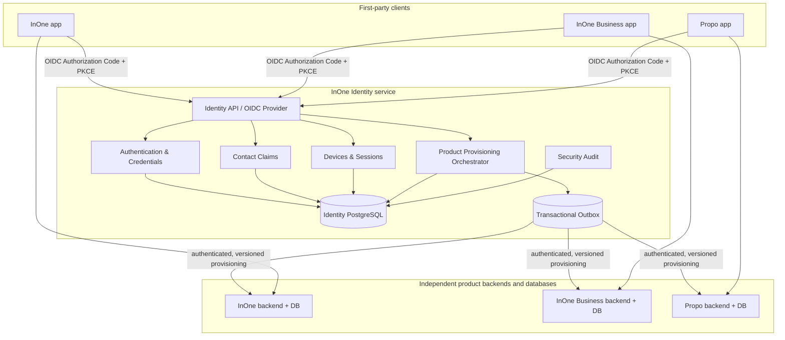

# InOne Identity — service architecture v0.1

**Status:** CTO architecture proposal based on owner-approved product direction; pending owner review of technical defaults  
**Date:** 2026-11-13  
**Branch:** `architecture/product-and-platform-blueprint-2026-11-13`  
**Scope:** Identity, authentication, contacts, sessions/devices, product-account provisioning, trust and recovery  
**Implementation status:** Documentation only. No service, database, API, UI, deployment or runtime behavior has been implemented.

## 1. Executive decision

Build **InOne Identity** as a separate platform service and the single authority for a person's central identity and authentication. Keep it independent from the InOne, InOne Business and Propo product backends.

Recommended initial implementation is a **modular monolith** with its own PostgreSQL database, internal modules, versioned HTTP APIs, OIDC/OAuth2-compatible authentication endpoints, and a transactional outbox. Do not split it into multiple microservices in v1.

Identity is not a universal business authorization service. It authenticates the person and issues product-scoped tokens. Each product backend remains authoritative for its own account state, data, membership and permissions.

### Owner-approved product behavior carried forward

- Registration requires both phone number and email.
- Personal registration through InOne provisions an InOne personal account and a reserved Propo personal account.
- Work onboarding through InOne Business provisions an InOne Business work account and a reserved Propo work account.
- A reserved Propo account cannot access Propo until first activation/sign-in on a Propo device.
- Personal and work product-account contexts remain distinct.
- Work onboarding uses an invitation and explicit acceptance.
- Product backends and databases remain separate.
- No SMS/email aggregators are available in the initial phase; contact points are stored as unverified claims.

This document turns that product behavior into a technical design. Technical defaults below are proposals until explicitly approved.

## 2. Core identity model

Keep the following entities distinct:

1. **Person identity** — immutable central `identity_id`, representing the authenticated human account in Identity.
2. **Contact point** — phone or email claimed by an identity, with independent verification status and lifecycle.
3. **Credential/authenticator** — password, passkey or other mechanism used to authenticate; not a contact point.
4. **Device** — an enrolled app installation/browser profile with its own device identifier and revocable sessions.
5. **Product account** — product-local principal owned by InOne, InOne Business or Propo and linked to the central identity.
6. **Account context** — `personal` or `work`; the same identity may have separate contexts in different products.
7. **Organization membership** — owned exclusively by InOne Business, not by Identity.

A single central identity can have:
- InOne personal + Propo personal;
- later, after accepting a Business invitation, InOne Business work + Propo work;
- separate sessions and devices for each product.

Do not create a second central identity merely because the person joins an organization. Do not merge two identities because their phone/email strings match. Linking two existing identities is a separate high-risk workflow requiring authentication to both identities and explicit consent.

## 3. Service topology and ownership

### 3.1 InOne Identity owns

- immutable `identity_id`;
- authentication credentials and authenticators;
- contact claims and verification status;
- login and session lifecycle;
- device enrollment and revocation;
- central security events and recovery cases;
- mapping between identity and product-local account IDs;
- durable orchestration state for product-account provisioning;
- token issuance, signing keys and client registration.

### 3.2 Each product owns

- its own product account ID and account profile;
- its domain data and product-specific preferences;
- its own authorization checks and resource access;
- its own account lifecycle state and product-specific activation;
- organization membership, positions, delegation, financial limits and audit in InOne Business;
- marketplace users, seller accounts, listings, orders and ratings in Propo;
- personal profile, social graph, chats, posts and communities in InOne.

Identity MUST NOT store product passwords, chats, listings, orders, CRM data, organization permissions or financial records.

### 3.3 Deployment recommendation

For v1:
- one independently deployable Identity application;
- one dedicated PostgreSQL database and database role;
- internal modules with explicit boundaries;
- background worker for outbox delivery/reconciliation;
- Redis only for ephemeral rate limits/short-lived coordination if needed, never as the source of truth;
- managed secret/KMS facility for signing and encryption keys;
- centralized logs/metrics/traces with PII redaction.

Do not introduce Kafka, a service mesh, or separate microservices solely for Identity v1. A database-backed outbox is sufficient initially.

## 4. Authentication protocol

### 4.1 Recommended standard

Use **OpenID Connect (OIDC) over OAuth 2.0 Authorization Code Flow with PKCE** for first-party mobile and web clients. Identity is the issuer. Each product app is a separately registered client with allowlisted redirect URIs and its own client ID.

Do not implement a custom token protocol or pass passwords between products.

### 4.2 Token types

- **ID token:** identity authentication result for the client; not an API authorization token.
- **Access token:** short-lived, audience-restricted token for one product API.
- **Refresh token:** opaque, high-entropy, rotated on every use; server stores only a cryptographic hash.
- **Service token:** machine-to-machine credential for product provisioning APIs; separate from user tokens.

Recommended starting policy (owner/security review required):
- access token lifetime: 5–10 minutes;
- refresh token: 30 days maximum inactivity, subject to risk and device policy;
- rotate refresh token on every refresh;
- reuse of an already-rotated refresh token revokes the associated token family/session and emits a security event;
- signing keys rotate with overlapping verification period;
- revoke sessions on password reset, credential compromise, account suspension or explicit device revocation.

Access token claims should be minimal:
`iss`, `sub` (central `identity_id`), `aud` (exact product API), `iat`, `exp`, `jti`, `sid`, `client_id`, `auth_time`, `amr` and optional `acr`.

Do not put phone/email, organization role, financial limit, department, or broad product permissions into long-lived tokens. Product APIs load current product account and authorization state locally. If a product-specific account ID is included as a claim, it must be scoped to that product audience and treated as a reference, not an authorization grant.

### 4.3 Authentication methods

Recommended initial credential:
- password stored only by Identity using Argon2id with parameters calibrated to production hardware;
- unique credential record, per-identity rate limits, breached-password screening when a suitable provider/source is selected;
- generic login failures that do not reveal whether a phone/email exists;
- password reset is not available through unverified contact claims alone.

Recommended next methods:
- passkeys/WebAuthn for phishing-resistant authentication;
- TOTP authenticator app as optional MFA;
- recovery codes generated once and shown only at creation;
- step-up authentication for sensitive account/security actions.

Biometrics are performed by the device/passkey platform; Identity should not receive or store biometric data.

Do not make SMS OTP a mandatory dependency for initial registration because no SMS provider is available. When a delivery provider is later added, contact verification becomes an additional factor and does not replace password/passkey security.

## 5. Mandatory contact collection without verification providers

### 5.1 Contact data model

Every registration collects:
- phone number in E.164 normalized form where possible, plus original display input;
- email normalized for lookup while preserving original display form.

Each contact point has:
- `type`: phone/email;
- `normalized_value`;
- `verification_status`: `unverified`, `pending`, `verified`, `rejected`;
- `claim_status`: `active`, `conflict`, `released`;
- `captured_at`, `source`, `verified_at`, `last_changed_at`;
- optional `superseded_by_contact_id`.

Do not infer verification from account creation, device activation, invitation acceptance or an administrator entering the contact.

### 5.2 Owner-approved uniqueness and reservation policy — Option A

**Owner decision: APPROVED — Option A (2026-11-13).** Phone numbers and email addresses are uniquely reserved across the entire InOne Identity system, using normalized values.

Normative v1 rules:
- At most one active claim may exist for each normalized phone number and each normalized email address across all identities.
- Normalize phone numbers to E.164 where possible. Normalize email for consistent lookup while preserving the original display value; do not invent provider-specific equivalence rules (for example, removing dots or plus-tags).
- Enforce uniqueness transactionally in the Identity database, not only in application code. Concurrent registrations for the same normalized contact must have exactly one winner.
- The first successful claim reserves the contact. A later registration attempting to claim it is blocked with a generic response that does not disclose whether a particular phone/email is registered.
- A conflict creates or routes to a restricted manual dispute case. No automatic account merge, identity link, contact transfer or ownership reassignment is allowed.
- A contact may be released or reassigned only after a controlled, documented and audited manual resolution by an authorized support/security operator. Record requester, reviewer, evidence reviewed, decision, affected identity/contact IDs, before/after state, reason and timestamps.
- Never reveal the current claimant's identity or full contact details to the requester. Support access is least-privilege and audited.
- Unverified reservation is not proof of real-world ownership. Until SMS/email proof-of-control is available, a claimant may have reserved someone else's contact. Device activation, invitation possession, password knowledge or a matching display name do not prove contact ownership.
- If a dispute cannot be resolved safely with available evidence, keep the reservation unchanged and deny reassignment; escalate rather than guess.

**Risk accepted by owner:** first-claim-wins can block the legitimate holder if another person registers the contact first. This is an explicit trade-off of Option A and requires a visible support/dispute path.

### 5.3 What unverified contacts may and may not do

Allowed:
- be stored as required registration attributes;
- be shown masked to the account holder;
- be used as candidate login identifiers together with a valid password, if the owner approves this login behavior;
- be used for internal duplicate/conflict detection.

Not allowed:
- prove identity or contact ownership;
- receive password reset or account takeover links;
- authorize financial operations or sensitive account changes;
- automatically merge/link accounts;
- receive third-party notifications before verification and consent;
- be shown in full to organization administrators or other users by default.

### 5.4 Contact change

Changing a phone/email is a security-sensitive operation:
1. require a valid authenticated session and step-up authentication;
2. add a new contact claim as unverified;
3. check uniqueness/conflict;
4. preserve the old contact and audit history;
5. do not transfer account ownership based only on the new string;
6. when verification delivery exists, verify the new contact before marking it verified;
7. define a controlled recovery/dispute process for users who lost access to old contact methods.

## 6. Registration and product-pair provisioning

Registration and provisioning are separate state machines. A successful HTTP request does not mean both product accounts are ready.

### 6.1 Personal registration via InOne

1. InOne client starts OIDC/registration flow with `entry_product=inone`, `account_context=personal`.
2. Identity collects required phone/email and credential, validates format and claim conflicts.
3. Identity creates `identity_id` in `pending_provisioning` and stores contacts as unverified.
4. Identity creates one durable provisioning operation and idempotency key.
5. InOne backend creates or idempotently returns the personal product account.
6. Propo backend creates or idempotently returns the personal Propo account with lifecycle `reserved`.
7. Identity records both product account IDs and acknowledgements.
8. Once both acknowledge, Identity marks pair provisioning complete; InOne account may enter `pending_activation`, Propo remains `reserved`.
9. First successful InOne device sign-in activates InOne. First successful Propo sign-in activates Propo independently.

### 6.2 Work onboarding via InOne Business invitation

1. Organization member with delegated authority creates an invitation in InOne Business.
2. Invitation is stored and managed by InOne Business; Identity does not own organization invitations or membership.
3. Invitee receives a single-use invitation link/code out-of-band while no mail/SMS provider exists.
4. Invitee opens the Business client, authenticates to an existing Identity or registers a new one with mandatory phone/email.
5. InOne Business validates invitation and invitee explicitly accepts it.
6. Business sends an authenticated provisioning request to Identity with an opaque invitation/acceptance reference and intended account context; it does not send permission grants for Identity to enforce.
7. Identity provisions/reuses InOne Business work account and Propo work reservation.
8. InOne Business creates membership and applies approved position, functional assignment, delegation, permissions and Financial authority block only after its own authorization checks.
9. InOne Business activates after first device enrollment/sign-in. Propo work remains reserved until first Propo activation.

An existing InOne personal identity can accept a Business invitation while signed in. It gains a work product context without merging personal and work data. If a user has multiple central identities, do not guess which one to use based on unverified contact matches; require explicit authenticated selection or a separately designed identity-linking flow.

### 6.3 Provisioning saga and failure handling

Use a durable saga, not a distributed transaction:
- Identity writes the identity, contact claims, provisioning operation and outbox event in one local database transaction.
- Worker sends idempotent provisioning commands to product backends.
- Product backend creates the product-local account under a unique idempotency key and returns its immutable account ID.
- Identity records the acknowledgement and advances the operation.
- Retries use the same operation ID and same intended product account ID.
- Reconciliation scans stale operations and safely retries or raises an operator-visible incident.

States:
- `pending`
- `provisioning`
- `partially_provisioned`
- `provisioned_pending_activation`
- `active_in_entry_product`
- `completed_pair_active`
- `failed_retryable`
- `blocked_conflict`
- `cancelled`

If one product succeeds and the other is unavailable, do not delete the successful account automatically. Keep it reserved/pending, retry the missing side and show a truthful pending state. Compensation is an explicit reviewed operation, not an automatic destructive rollback.

## 7. Device and session lifecycle

A device is an installation/browser profile, not a phone number and not proof of real-world identity.

Device record fields:
- immutable `device_id`;
- `identity_id`;
- client/application ID and platform;
- user-visible device name;
- created/last-seen timestamps;
- status `pending`, `active`, `revoked`;
- optional public key/device binding metadata;
- risk/security metadata with retention limits.

Rules:
- enroll a device only after successful authentication;
- device activation is per product session; signing into InOne does not activate Propo;
- show the user a device/session management screen;
- allow revocation of one device or all sessions;
- refresh-token rotation is tied to a device/session family;
- revoked devices cannot refresh sessions;
- do not treat device activation as verification of phone/email.

### 7.1 CTO decision — credential and account-recovery policy (v1)

**Status: CTO architecture decision for v1.** This policy is adopted as the technical baseline for Identity. It is not an owner-approved product feature scope or an implementation claim.

#### Credential baseline
- Password is the initial universal credential. Store only an Argon2id hash in Identity; calibrate parameters on production hardware, rate-limit by identity and network/device signals, and use generic authentication errors.
- Passkeys (WebAuthn) are the preferred phishing-resistant second authenticator and should be supported in the first secure release where the selected OIDC stack permits.
- TOTP authenticator app is an optional second authenticator. SMS/email OTP is not a recovery factor until a verified delivery-and-proof-of-control flow exists.
- Generate 10 single-use recovery codes (at least 128 bits of cryptographic randomness each) during recovery setup. Show them once, require explicit acknowledgement that they have been saved, and store only keyed hashes. Initial issuance requires recent password re-authentication; if passkey/TOTP is already enrolled, require it as additional step-up. Rotation requires a passkey/TOTP assertion or a fresh password re-authentication plus one unused recovery code. A code is consumed atomically and can never be reused. Rotating the set invalidates every previous code.
- Recovery codes are for account recovery only; they are not a login method for routine use, a step-up factor for financial approvals, or proof of phone/email ownership.
- Do not permit a user to disable their last usable authenticator/recovery path without first enrolling a replacement, except through the controlled recovery process.
- Before granting sensitive InOne Business financial permissions, require at least one passkey or TOTP authenticator and a fresh recovery-code set. Recovery codes cannot satisfy the step-up requirement for a financial operation.

#### Recovery methods and precedence
1. **Existing passkey:** the user proves possession with a fresh WebAuthn assertion, then may establish a new password or replace a lost authenticator.
2. **Existing trusted session/device:** an already-authenticated device may approve a recovery request only after fresh step-up using a previously enrolled passkey or TOTP. An unlocked app or an old session by itself is insufficient.
3. **One-time recovery code:** the user enters one unused recovery code. Identity issues a short-lived, single-use recovery grant bound to the identity, client, device and purpose. The grant expires after 10 minutes and cannot be exchanged for a general access token.
4. **No remaining authenticator or recovery code:** open a support recovery case, but do not reset credentials or transfer contacts based on unverified phone/email, password knowledge, invitation possession, device activation, organization confirmation, profile details or payment/account metadata alone. In v1, no manual override is allowed until an independent identity-proofing process with documented evidence standards, trained reviewers and a second approver is separately designed and approved. If proof cannot be established, access remains blocked.

#### Recovery sequence
1. User starts recovery using phone or email as a lookup identifier. The API returns the same generic response and status shape whether or not an account exists; it never confirms a contact claim or exposes available authenticators. The UI offers the same generic choices (use a passkey or enter a recovery code); the server validates the selected proof without exposing account-specific authenticator inventory.
2. The user completes a challenge with an enrolled passkey or one unused recovery code. A trusted-device approval is accepted only with fresh step-up as described above.
3. Identity validates the challenge, risk controls and rate limits, then creates a one-use recovery grant (10-minute lifetime, purpose-bound, client/device-bound).
4. The user sets a new password and reviews active devices/authenticators. The transaction consumes the grant, records the credential change, revokes all existing refresh-token families and sessions across InOne, InOne Business and Propo, and creates only a restricted recovery session on the current device.
5. If a recovery code was used, invalidate the entire old recovery-code set and require a new set to be generated before the user can restore sensitive Business permissions. The used code and all other old codes remain unusable.
6. A recovery-code reset places the identity under a 24-hour security hold. During the hold, block sensitive actions: financial initiation/approval, payout or bank-detail changes, owner/role changes, identity linking, disabling security controls and bulk exports. Normal low-risk account use may continue. This hold does not replace InOne Business's independent two-person approval policy.
7. Emit immutable audit/security events and show the recovery result in the account's security activity. Do not notify unverified phone/email addresses.

A passkey-based recovery with a fresh valid assertion does not require the 24-hour hold, but still revokes all other sessions after a password reset or authenticator replacement.

#### Contact changes while contacts are unverified
- A phone/email change requires a current authenticated session and fresh step-up with an enrolled passkey or TOTP. Password-only authentication and unverified contact challenges are insufficient.
- Reserve the new normalized value atomically as a pending change; keep the old claim active during a 72-hour cooling period. Revoke other sessions, preserve the initiating session, and block sensitive actions during the pending change.
- The user may cancel from the initiating trusted session with fresh step-up. On completion, mark the new claim active and release/supersede the old claim in one audited transaction. If the process is abandoned, expire the pending claim and preserve the old one.
- Because contacts are unverified, do not send security alerts to them or treat either value as proof of ownership. A contact already reserved by another identity follows the separate manual dispute policy; contact change never silently takes it over.
- If no passkey/TOTP exists, do not allow self-service contact replacement. Route to support; do not bypass the control using the unverified old/new contact.

#### Business and product boundaries
- A Business owner/admin may revoke or reissue a work invitation and manage organization membership within delegated authority. They cannot reset central Identity credentials, approve recovery for a personal identity, take over a Propo account, or access personal InOne data.
- Loss of a central Identity credential affects access to all linked product contexts. Recovery restores the central identity session; each product still independently checks local account state and authorization.
- If an employee cannot recover Identity, the organization may invite a newly authenticated identity as a new member. This does not transfer the old identity's personal data, chats, Propo history or account ownership. Any migration/linking requires a separate high-assurance, explicitly audited process.

#### Manual recovery case controls (future capability, not enabled in v1)
- Support can create a case and provide status without revealing whether a contact is registered.
- A future manual override requires independently verifiable identity proofing that does not rely on unverified contact claims, plus two-person review (case operator and independent security approver), immutable evidence/decision audit, a cooling period and notification through a newly verified channel.
- Until that proofing capability and its privacy/legal controls exist, the case can be investigated but cannot result in credential reset, contact reassignment or account transfer.

#### Required abuse controls and data model
- Rate-limit recovery start, challenge attempts, recovery-code attempts and manual case creation; add progressive delays and risk-based throttling without revealing account existence.
- Store recovery-code hashes, recovery grants (hashed token, purpose, expiry, consumed timestamp, client/device binding), recovery cases, security holds and authenticator lifecycle in Identity.
- Consume recovery grants and recovery codes atomically; make all completion operations idempotent and concurrency-safe.
- Record actor, identity, device, method, correlation ID, timestamp, result and reason code. Never log passwords, raw recovery codes, raw tokens or full contact values.
- Security events include identity.recovery.started, identity.recovery.challenge_succeeded, identity.recovery.completed, identity.recovery.denied, identity.credential.changed, identity.sessions.revoked, identity.contact_change.started, identity.contact_change.completed and identity.security_hold.placed/released.

**Security consequence:** with no verified contacts and no previously enrolled authenticator/recovery code, v1 intentionally fails closed. Account recovery may be impossible. The registration and security UI must tell users to save recovery codes and enroll a passkey; support must never promise recovery that the system cannot safely perform.

Detailed state machine, lost-device scenarios and implementation checklist: [IDENTITY-RECOVERY-FLOW-V0.1.md](IDENTITY-RECOVERY-FLOW-V0.1.md).

## 8. Product authorization and token exchange

Identity authenticates; product services authorize.

- InOne API validates tokens with audience `inone-api` and checks InOne account state.
- InOne Business API validates audience `inone-business-api` and checks active organization membership, position, functional assignment, atomic permission, scope, delegation and financial policy in its own database.
- Propo API validates audience `propo-api` and checks Propo account state and marketplace permissions in its own database.
- A token issued for one audience MUST be rejected by another product API.
- Product APIs must validate signature, issuer, audience, expiry, token ID and relevant session/revocation strategy.
- Use short-lived access tokens to bound revocation delay; high-risk actions also check current session/step-up state.
- Product APIs must enforce Identity security holds for high-risk actions using authenticated revocation/hold events plus a current-state check where required; never rely on a stale client claim. A recovery-code reset hold blocks the defined sensitive operations until expiry or audited security release.
- Sensitive InOne Business financial actions require a fresh passkey/TOTP step-up (recommended maximum age: 5 minutes), and the independent initiator/approver control remains mandatory. Recovery codes never satisfy financial step-up.
- Service-to-service provisioning uses separate credentials, mutual TLS or signed client credentials, allowlisted scopes and key rotation. Never reuse a user's access token for backend provisioning.

No product should trust a role, financial limit or membership value supplied by the client. Product authorization remains server-side.

## 9. Logical database model

Dedicated Identity PostgreSQL database. Names are proposed and are not migrations.

| Table | Purpose | Important fields / constraints |
|---|---|---|
| `identities` | central identity | `identity_id` UUID PK, status, created_at, disabled_at |
| `identity_contacts` | phone/email claims | contact_id, identity_id FK, type, normalized_value, verification_status, claim_status, timestamps |
| `auth_credentials` | password/passkey credential metadata | credential_id, identity_id, type, password_hash or public_key_ref, created_at, revoked_at |
| `identity_devices` | enrolled devices | device_id, identity_id, client_id, status, last_seen_at |
| `identity_sessions` | refresh/session family | session_id, identity_id, device_id, client_id, token_family, refresh_hash, expires_at, revoked_at |
| `product_account_links` | mapping to product-local principals | link_id, identity_id, product, account_context, product_account_id, status |
| `provisioning_operations` | saga state | operation_id, identity_id, entry_product, context, idempotency_key, state, attempts, last_error_code |
| `provisioning_steps` | per-product acknowledgements | operation_id, product, command_id, product_account_id, state, updated_at |
| `outbox_events` | durable event delivery | event_id, aggregate_id, event_type, payload_version, payload, published_at |
| `security_events` | append-only security audit | event_id, identity_id, event_type, actor, device_id, correlation_id, occurred_at, redacted metadata |
| `recovery_cases` | restricted recovery support workflow | case_id, identity_id, state, opened_at, reviewed_by, resolution_code, evidence_ref, second_approver_id |
| `recovery_codes` | one-time recovery secrets | code_id, identity_id, code_hash, created_at, consumed_at, revoked_at |
| `recovery_grants` | short-lived purpose-bound recovery grants | grant_id, identity_id, token_hash, purpose, client_id, device_id, expires_at, consumed_at |
| `security_holds` | temporary restrictions after high-risk recovery | hold_id, identity_id, reason, starts_at, ends_at, released_at, released_by |

Recommended constraints:
- unique `(identity_id, product, account_context)` for one account per product/context in v1;
- unique `(product, product_account_id)`;
- unique idempotency key within operation scope;
- one active password credential per identity unless multi-credential policy explicitly permits more;
- one active session refresh-token hash;
- database-enforced uniqueness for active normalized phone claims and active normalized email claims, implementing the owner-approved first-claim-wins policy;
- use a keyed HMAC/blind index for normalized lookup so uniqueness can be enforced without exposing plaintext values in indexes; encrypt raw sensitive contact values at rest and keep encryption keys outside the database.

The global phone/email uniqueness policy is owner-approved. Exact DDL, index lifecycle, encrypted lookup implementation and migration strategy remain engineering design tasks; they are not implemented by this document.

## 10. API surface — v1 proposal

All endpoints versioned under `/v1`. JSON schemas and exact error payloads are specified in the companion API contract.

Public/client endpoints:
- `POST /v1/registrations` — start personal registration or a registration bound to an invitation acceptance context.
- `POST /v1/auth/authorize` / standard OIDC authorization endpoints — start OIDC flow.
- `POST /v1/auth/token` — authorization-code exchange and refresh-token rotation.
- `POST /v1/auth/logout` — revoke current session/token family.
- `GET /v1/me` — central identity summary and masked contacts.
- `GET /v1/me/contacts` — own contact points and verification status.
- `POST /v1/me/contacts` — add contact claim.
- `DELETE /v1/me/contacts/{contact_id}` — remove/supersede contact subject to recovery safeguards.
- `GET /v1/me/devices`, `DELETE /v1/me/devices/{device_id}` — device management.
- `POST /v1/me/credentials/password` — change password with step-up.
- `POST /v1/me/credentials/passkeys/*` — passkey enrollment/removal when implemented.
- `POST /v1/me/recovery-codes/rotate` — rotate recovery codes with step-up.

Machine-to-machine endpoints:
- `POST /v1/internal/provisioning/operations` — create/reuse a provisioning operation after trusted product request.
- `POST /v1/internal/provisioning/acknowledgements` — product backend acknowledges account creation.
- `GET /v1/internal/provisioning/operations/{operation_id}` — query operation state.
- `POST /v1/internal/identity/resolve` — restricted service lookup by immutable identity reference, not public contact enumeration.
- `GET /.well-known/openid-configuration` and JWKS endpoint — OIDC metadata and public signing keys.

Do not expose a public endpoint that returns whether an arbitrary phone/email is registered. Apply rate limits, abuse detection, request size limits, idempotency and generic responses.

## 11. Security baseline

- TLS everywhere; service-to-service authentication and least-privilege scopes.
- Argon2id password hashing; never log passwords, tokens, recovery codes or full contact values.
- Encrypt contact values and sensitive recovery data at rest; HMAC blind indexes for lookup.
- CSRF protection for browser-based flows; strict redirect URI allowlists; PKCE for public clients.
- Refresh-token rotation and reuse detection.
- Rate limits by IP, device, identity, contact-claim fingerprint and risk signal; avoid permanent lockout from attacker-triggered attempts.
- Generic registration/login/recovery responses to prevent account enumeration.
- Security audit for credential, contact, device, session, identity-link and provisioning changes.
- Redact PII from logs/traces; never put contact values or secrets in URLs.
- Administrative access to Identity support tools is break-glass, least privilege, time-limited and audited.
- Signing key rotation, secret rotation, backups and tested restore.
- Threat model and penetration testing before production.

## 12. Observability and operations

Required metrics:
- registration started/completed/blocked;
- provisioning operations by state, product, age and retry count;
- product acknowledgement latency and failure rate;
- authentication success/failure by client and reason class;
- refresh-token reuse detections;
- active/revoked devices and sessions;
- contact-claim conflicts and recovery case age;
- OIDC/JWKS/key rotation health.

Required operational workflows:
- inspect provisioning operation by correlation ID;
- retry safe failed step;
- reconcile Identity mapping with product-local account IDs;
- revoke compromised sessions/devices;
- rotate signing/service credentials;
- resolve contact conflict through audited workflow;
- export security audit for authorized incident response.

Never provide an operator with an action to silently take over a user's identity.

## 13. Implementation sequence

1. **Architecture freeze:** threat-model the approved contact reservation and CTO recovery baseline; finalize token/session lifetimes, device policy and Propo account-context contract.
2. **Identity foundation:** database, migrations, config/secrets, health checks, audit, observability.
3. **Authentication:** OIDC Authorization Code + PKCE, Argon2id password, passkeys, optional TOTP, recovery-code issuance, sessions, refresh rotation, logout and JWKS.
4. **Contact claims:** required phone/email collection, normalization, unverified state, conflict-safe operations.
5. **Product provisioning:** product adapters, outbox/inbox, idempotency, retries, reconciliation and account mapping.
6. **Device and recovery lifecycle:** device enrollment, session management, recovery grants/codes, security holds, support-case controls and revocation.
7. **Business invitations:** integrate Business-owned invitation acceptance and membership activation.
8. **Propo integration:** confirm Propo APIs and support for personal/work account contexts; then implement its adapter.
9. **Hardening:** threat model, recovery abuse controls, penetration tests, backup/restore and failure drills.
10. **Client integration:** InOne, InOne Business and Propo login/registration UI and product-scoped session handling.

Each stage requires tests and review before proceeding to the next. No stage is implemented by this architecture document.

## 14. Open owner decisions / technical gates

The following are intentionally not silently decided:
1. **DECIDED — contact uniqueness, Option A (owner-approved 2026-11-13):** first-claim-wins global reservation for normalized phone/email, generic conflict response, restricted manual dispute review, no automatic transfer/merge/link. The unverified-contact squatting risk is explicitly accepted. Remaining work: define operator access, evidence standards, escalation, retention and user-facing support flow.
2. **CTO DECIDED — login identifier:** the user may sign in with either claimed phone or claimed email plus password. Both remain unverified lookup identifiers; neither is proof of contact ownership, MFA or recovery.
3. **CTO DECISION — credential baseline and recovery v1:** Argon2id password; passkeys preferred; optional TOTP; 10 single-use recovery codes; recovery only by enrolled passkey, fresh trusted-device step-up or recovery code; no reset through unverified contacts. If all authenticators/codes are lost, no v1 manual override until independent identity-proofing and two-person review exist.
4. **CTO DECISION — recovery controls:** one-use 10-minute purpose-bound grant; revoke all sessions after password reset; 24-hour hold on sensitive operations after recovery-code reset; contact replacement requires passkey/TOTP step-up and 72-hour cooling period.
5. **CTO DECIDED — token/session defaults:** 5-minute access tokens; rotating opaque refresh tokens; 30-day inactivity expiry; 90-day absolute session lifetime; refresh-token reuse revokes the active family; sensitive-action step-up age is at most 5 minutes.
6. **Business invitation authority:** invitation remains owned by InOne Business; Identity authenticates invitee and provisions the account pair.
7. **Propo contract:** confirm Propo can maintain separate personal/work account principals and return stable account IDs. This is a blocking integration dependency.

The login identifier and token/session defaults are now fixed CTO technical decisions. The stack is recorded in [ADR-IDENTITY-STACK-001](identity/ADR-IDENTITY-STACK-001.md). Propo's stable personal/work principals and API contract remain the blocking product-integration dependency. Stage 0 contracts and readiness gates are maintained in [Identity Stage 0](identity/STAGE-0-ENGINEERING-READINESS.md). This remains a design specification, not an implementation or production authorization.

## 15. Non-goals

- No shared user database across products.
- No direct cross-product SQL.
- No shared global product authorization or role catalogue in Identity.
- No automatic account merge by matching phone/email.
- No use of unverified contact claims as MFA or recovery.
- No automatic notification delivery through unverified contact points.
- No automatic deletion of paired accounts when one product remains unused.
- No production claim until implementation, security review and acceptance tests are complete.
