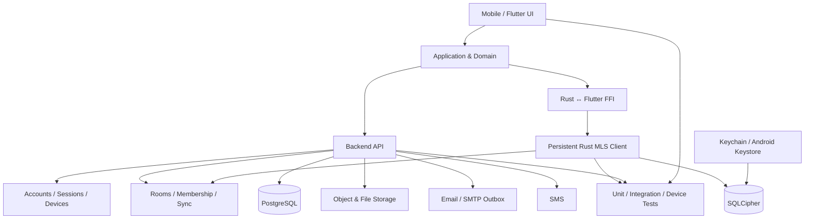

# InOne — архитектурный каркас репозитория

**Версия:** 1.0  
**Срез GitHub:** 2026-11-18  
**Репозиторий:** [vahe210991-cloud/InOne-chat](https://github.com/vahe210991-cloud/InOne-chat)  
**Базовая ветка:** `main`  
**SHA базовой ветки на момент подготовки:** `d9d699f1c7e27107123c8a019a780f7060531a08`  
**Назначение:** показать InOne как систему — от продуктовых областей до подсистем, а не как перечень файловых путей.

> Это архитектурная карта по структуре `main`, коду и имеющимся проектным документам. Она разделяет подтверждённые компоненты, проектные направления и незавершённую разработку. Наличие модуля или ветки не означает, что соответствующая функция уже готова для эксплуатации.

## 1. Как читать каркас

- **[В MAIN]** — текущая история ветки полностью содержится в `main` по GitHub Compare (`ahead_by = 0`).
- **[НЕ СЛИТА]** — ветка содержит коммиты, которых нет в `main`. Даже если её PR уже слит в промежуточную ветку, это не означает слияния в `main`.
- **[НЕ ОПРЕДЕЛЕНО]** — сравнение ancestry не дало надёжного результата.
- **[ОСНОВНАЯ]** — сама ветка `main`.
- Ветки, относящиеся сразу к нескольким слоям, перечислены в основном месте и дополнительно отмечены в разделе сквозных компонентов.
- Состояние веток — снимок на 2026-11-18. Перед merge, rebase или удалением ветки статус нужно перепроверить по текущему GitHub.

## 2. Каркас верхнего уровня

```text
INONE — SECURE COMMUNICATION & PRODUCT PLATFORM
│
├── A. PRODUCT EXPERIENCE
│   ├── A1. InOne Mobile Application
│   │   ├── Native Flutter shell
│   │   ├── Screen system & navigation
│   │   ├── UI assets / approved visual reference
│   │   ├── Application state & sessions
│   │   └── API client / transport
│   │
│   ├── A2. Client Experience 0.7
│   │   ├── Authentication & registration screens
│   │   ├── Recovery screens
│   │   └── Shared client components
│   │
│   └── A3. Product modules
│       ├── Personal accounts & profiles
│       ├── Chats & rooms
│       ├── Organizations
│       └── Search / user discovery
│
├── B. CORE BACKEND
│   ├── HTTP server & API routing
│   ├── Account / authentication / sessions
│   ├── Device lifecycle
│   ├── Rooms / membership / invitations
│   ├── Organizations / roles / permissions
│   ├── Synchronization & event delivery
│   ├── Recovery workflows
│   └── Administration & feature configuration
│
├── C. MESSAGING & CRYPTOGRAPHY
│   ├── MLS protocol integration
│   ├── Persistent Rust MLS client
│   ├── Rust ↔ Flutter FFI bridge
│   ├── Group state / epochs / key packages
│   ├── Message encrypt / decrypt
│   ├── Durable outbox / retry / sync
│   ├── Device removal from MLS groups
│   └── Encrypted attachment pipeline
│
├── D. DATA & STORAGE
│   ├── Server database (PostgreSQL)
│   ├── Schema & migrations
│   ├── Local encrypted database (SQLCipher)
│   ├── Platform key storage (Keychain / Keystore)
│   ├── Object / file storage
│   └── Test-only memory store & fixtures
│
├── E. SECURITY & TRUST
│   ├── Identity & account rules
│   ├── Authentication hardening / throttling
│   ├── Device trust / approval / revocation
│   ├── Recovery & account restoration
│   ├── Authorization / room & organization policy
│   ├── Cryptographic key lifecycle
│   └── API error disclosure / secret hygiene
│
├── F. COMMUNICATION & INTEGRATIONS
│   ├── Email delivery (SMTP / durable outbox)
│   ├── SMS delivery
│   ├── Push token registration
│   ├── OneBot / StickyBot contracts (proposal / audit)
│   └── External service integration contracts
│
└── G. ENGINEERING & GOVERNANCE
    ├── Automated / unit / integration tests
    ├── CI workflows & build scripts
    ├── API contracts & architecture decisions
    ├── Recovery artifacts & historical archives
    ├── Development reports & handover records
    └── Branch / Pull Request integration graph
```

## 3. Подробная архитектура и расположение в репозитории

### A. Product Experience — пользовательское приложение

**A1. InOne Mobile Application**

Репозиторий содержит Flutter/Dart приложение и связанные клиентские слои. В текущем `main` обнаружены:
- экранный каталог и точка входа приложения;
- слой данных, сетевой слой, сессии и тестовый API;
- каталоги утверждённых UI-материалов и тестовых экранов.

Архитектурные обязанности:
1. Presentation — экраны, навигация, UI-компоненты и дизайн-ресурсы.
2. Application — пользовательские сценарии и координация операций.
3. Domain — модели аккаунта, чата, комнаты, устройства и организации.
4. Infrastructure — API transport, локальное хранение, сессии и native bridge.

**A2. Client Experience 0.7**

Отдельный набор клиентских экранов и общих компонентов. Это не следует путать с основным мобильным приложением Beta 1.0: это отдельная линия клиентского опыта и reference-реализации.

**Подтверждённые корни в репозитории**
- `mobile/` — Flutter application, assets, tests и tooling.
- `inone-development-0.7/stage-0.7.0/client-screens/` — клиентские экраны и общие компоненты 0.7.
- `inone-development-archive-0.6.0/client-reference/` — архивные/reference-клиенты, не считать автоматически текущим продуктовым UI.

**Ветки, относящиеся к этому блоку**

| Ветка | Статус относительно main | Связь |
|---|---|---|
| `feat/flutter-ui-dart-migration-2026-11-14` | НЕ СЛИТА | #52 — Flutter-native migration |
| `feature/beta1-screen-api-integration-2026-11-12` | НЕ СЛИТА | #48 — screen/API integration |
| `feature/beta1-native-chats-screen-2026-11-12` | НЕ СЛИТА | #49 — native Chats screen |
| `feat/beta1-backend-api-foundation` | НЕ СЛИТА | #23 — typed API transport |
| `feat/beta1-approved-html-webview` | НЕ СЛИТА | #21 merged; ветка всё ещё имеет уникальные commits |
| `feat/beta1-full-screen-api-harness` | В MAIN | #28 merged |
| `feat/beta1-chat-room-list-data` | В MAIN | ветка уже содержится в main |
| `feat/beta1-ui-source-integration` | В MAIN | #35 merged |
| `feat/claude-ui-beta1-integration` | В MAIN | история уже содержится в main |
| `feat/inone-phone-web-preview` | НЕ СЛИТА | #29 — phone preview |
| `feat/ui-approval-webview-runtime-2026-11-09` | НЕ СЛИТА | #37 merged, но в ветке остались уникальные commits |
| `task/ui-archive-import-2026-11-09` | В MAIN | #36 merged |
| `docs/flutter-screen-handoff-claude` | НЕ СЛИТА | #20 merged, но ветка не полностью совпадает с main |

### B. Core Backend — серверная платформа

Backend является центральным API и доверенной серверной стороной. В дереве движка обнаружены отдельные модули для сервера, правил аккаунтов, сессий, комнат, организаций, восстановления, MLS-маршрутов, файлов, SMTP/SMS и хранилищ.

**Функциональные подсистемы**
- API runtime — запуск сервера, маршрутизация, конфигурация и middleware.
- Account & Auth — регистрация, вход, подтверждение, refresh/logout, профили и PIN.
- Session & Device — сессии, refresh tokens, устройства, approvals, push-token registration.
- Rooms & Messaging API — комнаты, участники, приглашения, события, синхронизация.
- Organizations — организации, заявки, связи, роли и права доступа.
- Recovery — сценарии восстановления и отмены восстановления.
- Administration — платформенные роли, журналы административных действий и feature flags.
- Files API — метаданные файлов, выдача и отзыв доступа к объектам.

**Подтверждённые корни**
- `inone-engine-poc-0.6.0/src/` — Node.js backend и серверные правила.
- `inone-engine-poc-0.6.0/migrations/` — SQL migrations.
- `inone-development-archive-0.6.0/engine/` — отдельный исторический engine archive; не считать его идентичным POC без сравнения.

**Ветки Backend/API**

| Ветка | Статус | Связь |
|---|---|---|
| `feature/stage-3-api-contracts-2026-11-11` | НЕ СЛИТА | #44 merged into main, но в ветке есть уникальные commits |
| `audit/stage-3-api-backend-2026-11-11` | НЕ СЛИТА | аудит API/backend |
| `feat/beta1-backend-api-foundation` | НЕ СЛИТА | #23 |
| `feature/beta1-screen-api-integration-2026-11-12` | НЕ СЛИТА | #48 |
| `feature/beta1-native-chats-screen-2026-11-12` | НЕ СЛИТА | #49 |
| `feature/email-delivery-service-2026-11-16` | В MAIN | уникальных commits относительно main нет |
| `feature/email-delivery-service-2026-11-16-b1` | НЕ СЛИТА | #61 — текущая отдельная Beta 1.0 email line |
| `fix/api-error-disclosure-2026-11-16` | НЕ СЛИТА | #65 → email-b1 |
| `fix/backend-revocable-file-downloads-2026-11-15` | НЕ СЛИТА | #54 merged into Flutter migration |
| `fix/beta1-pretest-readiness-2026-11-16` | НЕ СЛИТА | #67 merged into email-b1 |
| `fix/beta1-test-readiness-2026-11-16` | НЕ СЛИТА | #68 closed without merge |
| `fix/beta1-test-readiness-2026-11-16b` | НЕ СЛИТА | #69 closed without merge |
| `fix/ci-readonly-rust-format-2026-11-16` | НЕ СЛИТА | #66 |
| `fix/security-hygiene-and-ci-2026-11-16` | НЕ СЛИТА | #63 |
| `security/f01-f02-pg-verify-2026-11-10` | НЕ СЛИТА | #42 — PostgreSQL security verification |
| `planning/beta-2.0-roadmap` | НЕ СЛИТА | #27 — roadmap, не backend implementation |

### C. Messaging & Cryptography — сообщения и MLS

Этот слой обеспечивает end-to-end защищённые группы и сообщения. Серверная часть маршрутизирует зашифрованные данные; клиентское Rust-ядро отвечает за криптографическое состояние и обработку MLS.

**Подсистемы**
- MLS protocol — group state, epochs, commits, welcomes и key packages.
- Persistent Rust client — устойчивое состояние клиента, операции над группами и сообщения.
- Flutter FFI bridge — вызов Rust MLS runtime из Flutter.
- Message lifecycle — encrypt, send, sync, decrypt, durable local persistence.
- Outbox — повторная отправка и reconciliation после временных сбоев.
- Device lifecycle — удаление отозванных устройств из групп.
- Attachment security — шифрование содержимого файла и безопасный transport через API.

**Подтверждённые корни**
- `inone-engine-poc-0.6.0/mobile-mls/mls-client/` — Rust MLS client.
- `inone-engine-poc-0.6.0/mobile-mls/mls-bridge/` — Rust bridge prototype.
- `mobile/rust/` — native Rust/Flutter integration, если присутствует в соответствующей рабочей ветке; наличие в одной ветке не означает наличие на main.

**Ветки MLS / Messaging**

| Ветка | Статус | Связь |
|---|---|---|
| `feature/stage-4-native-mls-runtime-2026-11-11` | НЕ СЛИТА | #45 — Stage 4 native MLS |
| `feat/openmls-client-ci-baseline` | НЕ СЛИТА | #39 — OpenMLS client baseline |
| `feat/openmls-frb-bridge` | НЕ СЛИТА | #40 — FRB bridge |
| `feat/native-mls-persistent-ffi-2026-11-15` | НЕ СЛИТА | #58 — persistent Rust runtime + Flutter bridge |
| `feat/mls-attachment-aead-core-2026-11-15` | НЕ СЛИТА | #57 — attachment AEAD core |
| `feat/mls-encrypted-attachment-flow-2026-11-15` | НЕ СЛИТА | #59 — encrypted attachment flow |
| `feat/mobile-authenticated-file-download-transport-2026-11-15` | НЕ СЛИТА | #55 closed without merge |
| `feat/mobile-authenticated-file-download-transport-v2-2026-11-15` | НЕ СЛИТА | #56 merged into Flutter migration |
| `task/beta1-stage4-mls-merge-audit-2026-11-14` | НЕ СЛИТА | #53 — integration audit |
| `docs/stage-4-native-mls-triage-2026-11-11` | НЕ СЛИТА | #46 closed without merge |
| `feat/recovery-confirmation-deep-links-2026-11-15` | НЕ СЛИТА | recovery confirmation entry point |

### D. Data & Storage — базы и файлы

**Подсистемы**
- PostgreSQL — серверная operational database.
- Schema & migrations — версия и эволюция серверной схемы.
- SQLCipher — локальная зашифрованная база MLS-клиента.
- Key storage — абстракция ключевого хранилища; platform adapters требуют отдельной проверки на iOS/Android.
- Object storage — файловые объекты и атомарная запись.
- Memory store — тестовый backend storage, не production database.

**Подтверждённые корни**
- `inone-engine-poc-0.6.0/src/schema.sql`
- `inone-engine-poc-0.6.0/migrations/`
- `inone-engine-poc-0.6.0/src/store.js`
- `inone-engine-poc-0.6.0/src/store-memory.js`
- `inone-engine-poc-0.6.0/src/object-store.js`
- `inone-engine-poc-0.6.0/mobile-mls/mls-client/`

**Ветки Storage / Files**
- `feat/mls-attachment-aead-core-2026-11-15` — НЕ СЛИТА; #57.
- `feat/mls-encrypted-attachment-flow-2026-11-15` — НЕ СЛИТА; #59.
- `feat/mobile-authenticated-file-download-transport-2026-11-15` — НЕ СЛИТА; #55.
- `feat/mobile-authenticated-file-download-transport-v2-2026-11-15` — НЕ СЛИТА; #56.
- `fix/backend-revocable-file-downloads-2026-11-15` — НЕ СЛИТА; #54.
- `security/f01-f02-pg-verify-2026-11-10` — НЕ СЛИТА; #42.

### E. Security & Trust — безопасность и доверие

**Подсистемы**
- Identity & account policy — идентификаторы, правила регистрации и локализация.
- Authentication protection — throttle, rate limits, verification codes и защита входа.
- Device trust — approval, device listing, revocation и отзыв ключевого материала.
- Recovery — восстановление доступа, подтверждения и безопасная отмена.
- Authorization — membership, organization policy, room permissions.
- Cryptographic trust — MLS credentials, key packages, local encrypted storage.
- Security hygiene — отсутствие секретов в исходниках/логах и минимизация раскрытия внутренних ошибок.

**Ветки Security / Identity / Recovery**

| Ветка | Статус | Связь |
|---|---|---|
| `stage0/identity-engineering-readiness-2026-11-13` | НЕ СЛИТА | #51 → architecture blueprint |
| `stage0/identity-readiness-2026-11-13` | НЕ СЛИТА | Identity readiness |
| `docs/inone-identity-design-localization` | НЕ СЛИТА | Identity design / localization |
| `feat/recovery-confirmation-deep-links-2026-11-15` | НЕ СЛИТА | recovery deep links |
| `fix/security-hygiene-and-ci-2026-11-16` | НЕ СЛИТА | #63 |
| `fix/api-error-disclosure-2026-11-16` | НЕ СЛИТА | #65 |
| `audit/beta1-beta2-full-audit-2026-11-09` | НЕ СЛИТА | #34 |
| `audit/onebot-stickybot-contract-readiness-2026-11-16` | НЕ СЛИТА | #62 — contract readiness |
| `cto/inone-audit-2026-11-08` | НЕ СЛИТА | #15 merged, но branch содержит уникальные commits |

### F. Communication & Integrations — доставка и внешние сервисы

**Подсистемы**
- Email delivery — отправка подтверждений и служебных писем, SMTP transport, durable outbox и retry/lease lifecycle.
- SMS — интерфейс/провайдер SMS.
- Push — регистрация push tokens; наличие регистрации не доказывает готовность полного FCM/APNs sender.
- Bot contracts — OneBot / StickyBot пока отражены в архитектурных предложениях и аудитах; не считать завершённой интеграцией.
- External contracts — versioned contracts, ownership, authentication, consent and failure semantics.

**Ветки Email / Integrations**

| Ветка | Статус | Связь |
|---|---|---|
| `feature/email-delivery-service-2026-11-16-b1` | НЕ СЛИТА | #61 — Beta 1.0 email delivery |
| `docs/beta1-email-delivery-stage-report-2026-11-18` | НЕ СЛИТА | #77 → email-b1 |
| `fix/email-ci-server-regex-2026-11-17` | НЕ СЛИТА | #72 → email-b1 |
| `fix/email-delivery-shutdown-and-key-hardening-2026-11-17` | НЕ СЛИТА | #71 merged into email-b1 |
| `fix/email-delivery-test-readiness-2026-11-17` | НЕ СЛИТА | #70 merged into email-b1 |
| `fix/email-outbox-key-canonicalization-2026-11-17` | НЕ СЛИТА | #73 merged into test-readiness |
| `fix/email-outbox-lease-renewal-2026-11-16` | НЕ СЛИТА | #64 → email-b1 |
| `feature/registration-email-live-smoke-2026-11-18` | НЕ СЛИТА | #74 merged into email-b1 |
| `audit/onebot-stickybot-contract-readiness-2026-11-16` | НЕ СЛИТА | #62 |
| `docs/bots-stickers-platform-2026-11-16` | НЕ СЛИТА | #60 |

### G. Engineering & Governance — качество, документация и история

**Подсистемы**
- Tests — unit, integration, PostgreSQL, Rust MLS, Flutter and device tests.
- CI/build — workflows, format checks, native build scripts.
- Architecture — ADR, system blueprint, product boundaries and contracts.
- Recovery/archive — preserved bundles, source archives, snapshots and validation records.
- Continuity — session log, baseline, source-of-truth and handover.
- Branch governance — PR graph, ancestry and safe merge rules.

**Ветки сквозной инженерной работы**

| Ветка | Статус | Область |
|---|---|---|
| `architecture/product-and-platform-blueprint-2026-11-13` | НЕ СЛИТА | #50 — architecture blueprint |
| `planning/beta-2.0-roadmap` | НЕ СЛИТА | #27 — roadmap |
| `automation/daily-audit-2026-11-09-1303` | НЕ СЛИТА | #38 — daily audit |
| `ci/inone-engine-validation-2026-11-07` | НЕ СЛИТА | #10 — CI |
| `fix/ci-readonly-rust-format-2026-11-16` | НЕ СЛИТА | #66 — CI permissions |
| `docs/mandatory-ai-agent-protocol-2026-11-09` | НЕ СЛИТА | #33 — agent protocol |
| `docs/development-environment-2026-11-13` | НЕ СЛИТА | development environment |
| `docs/dev-report-2026-11-09-0809` | НЕ СЛИТА | #32 — status report |
| `docs/beta1-system-audit-ui-gap-plan-2026-11-12` | НЕ СЛИТА | #47 — system audit |
| `recovery/p0-reimplementation` | В MAIN | #25 merged; current branch ancestry has no unique commits |
| `recovery/p0-wave3-applied` | В MAIN | #22 merged; current branch ancestry has no unique commits |
| `recovery/p0-wave3-rustfmt` | В MAIN | #24 merged; current branch ancestry has no unique commits |
| `recovery/p0-wave3-validation` | НЕ СЛИТА | #18 |
| `recovery/p0-wave3-validation-rerun` | НЕ СЛИТА | #19 closed without merge |
| `recovery/source-artifacts-2026-11-08` | НЕ СЛИТА | #17 |
| `snapshot/p0-and-groups-2026-11-08` | НЕ СЛИТА | #26 |
| `cleanup/remove-duplicate-archive-readme-2026-11-11` | НЕ СЛИТА | #43 merged, branch still has unique commits |
| `docs/stage-4-native-mls-triage-2026-11-11` | НЕ СЛИТА | #46 closed without merge |
| `docs/bots-stickers-platform-2026-11-16` | НЕ СЛИТА | #60 |
| `docs/beta1-email-delivery-stage-report-2026-11-18` | НЕ СЛИТА | #77 |

## 4. Исторические и вспомогательные линии

Эти ветки не следует автоматически трактовать как самостоятельные продуктовые модули.

| Ветка | Статус | Назначение / примечание |
|---|---|---|
| `development` | В MAIN | историческая линия; HEAD совпадает с engine-poc |
| `engine-poc` | В MAIN | историческая линия; HEAD совпадает с development |
| `artifacts/p0-bundles` | НЕ ОПРЕДЕЛЕНО | GitHub Compare сообщил отсутствие общего предка с main; не удалять без отдельного provenance audit |
| `tmp/beta1-pretest-rebase-2026-11-16` | НЕ СЛИТА | временная линия подготовки |
| `tmp/rebase-pr71-2026-11-17` | НЕ СЛИТА | временная линия rebase |
| `task/beta1-stage4-mls-merge-audit-2026-11-14` | НЕ СЛИТА | cross-module integration audit |
| `docs/flutter-screen-handoff-claude` | НЕ СЛИТА | handoff documentation |
| `docs/inone-identity-design-localization` | НЕ СЛИТА | identity design reference |
| `audit/stage-3-api-backend-2026-11-11` | НЕ СЛИТА | backend audit |
| `audit/beta1-beta2-full-audit-2026-11-09` | НЕ СЛИТА | product scope audit |

## 5. Граф связей между архитектурными слоями



Схема показывает логические связи, а не подтверждённый production deployment или фактический runtime wiring всех модулей. Перед утверждением полного end-to-end потока необходимы тесты и проверка конкретных вызовов.

## 6. Сводка веток

Срез реестра GitHub на 2026-11-18:
- Всего веток: **72** (включая `main`).
- Полностью содержатся в истории `main`: **11**.
- Не слиты в `main`: **59**.
- Не удалось определить ancestry: **1** (`artifacts/p0-bundles`).
- Основная ветка: `main`.

Полный перечень веток и PR с ahead/behind, HEAD SHA и исходными/целевыми ветками сохранён в отдельном документе: [Repository Branch Map](repository-branch-map-2026-11-18.md).

## 7. Границы достоверности и незакрытые вопросы

1. Каркас группирует текущие компоненты по архитектурным обязанностям. Он не является доказательством, что каждый блок реализован или связан в работающий end-to-end поток.
2. `inone-engine-poc-0.6.0`, `inone-development-archive-0.6.0` и `inone-development-0.7` — разные линии исходников. Не объединять их смыслово без проверки происхождения, commit ancestry и diff.
3. `mobile/rust` и часть актуальной Flutter/MLS интеграции могут присутствовать в рабочих ветках, но отсутствовать в `main`. Статус проверять на целевом ref, а не по наличию ветки.
4. Push token registration не равнозначен готовой доставке push через FCM/APNs.
5. Bot/Sticker материалы — архитектурные предложения и аудит контрактов; не заявлять production integration.
6. Platform Keychain/Keystore adapters, SQLCipher key transfer, native device acceptance и iOS/Android runtime wiring требуют отдельной проверки на реальных платформах.
7. Branch status — только Git ancestry. Он не оценивает качество, безопасность, тестовое покрытие или то, не были ли изменения cherry-pick/revert.

## 8. Правило обновления документа

Обновлять этот каркас после существенного изменения границ модулей, появления/удаления подсистемы или изменения связей между слоями. Статусы веток обновлять по свежим GitHub refs и Compare, не вручную по состоянию PR. Не объединять документ с `main` и не удалять ветки без отдельного решения владельца.


## 9. Документационные ветки каркаса и реестра

Эти ветки обслуживают сами архитектурные документы, поэтому не относятся к runtime-модулям продукта. Они включены в актуальный перечень refs, но вынесены отдельно, чтобы не смешивать структуру продукта со структурой документации.

| Ветка | Статус | Назначение |
|---|---|---|
| `docs/repository-branch-map-2026-11-18` | НЕ СЛИТА | полный реестр веток, ancestry и PR; отдельный документ |
| `docs/inone-architecture-skeleton-2026-11-18` | НЕ СЛИТА | текущая архитектурная карта; создана от main для review |

**Счётчик:** исходный снимок проектных веток содержал 72 refs. Две документационные ветки, перечисленные выше, относятся к ведению карты/реестра и добавлены отдельно. В актуальном GitHub branch list после создания этого документа видно 74 refs: 72 исходных refs + 2 документационные refs. Не включать эту разницу в продуктовые/инженерные ветки при анализе готовности Beta 1.0.
