# InOne — карта веток GitHub и статусы слияния

- Репозиторий: https://github.com/vahe210991-cloud/InOne-chat
- Снимок данных: **2026-11-18**
- Основная ветка для проверки слияния: `main`
- Проверено: **72 веток**, **34 открытых Pull Requests**.
- Определение статуса: ветка считается **слитой в main**, только если GitHub Compare показывает `ahead_by = 0` при сравнении `main...ветка`. Если `ahead_by > 0`, ветка содержит коммиты, которых нет в `main`, даже если отдельный PR этой ветки был слит в другую рабочую ветку.
- SHA в таблице сокращён до 6 символов; полные SHA доступны на страницах веток GitHub.

## Сводка

- Слиты в `main` по проверке ancestry: **11**.
- Не слиты в `main`: **59**.
- Не удалось определить ancestry: **1**.
- Открытые PR: **34**.

> Важно: «PR merged» и «ветка полностью слита в main» — разные вещи. Ветка может быть источником PR, слитого в промежуточную ветку, и при этом оставаться неслитой в main. Закрытый PR без `merged_at` также не считается успешным слиянием.

## 1. Полный реестр веток

| Ветка | HEAD SHA | Статус относительно main | ahead / behind | PR / связь |
|---|---|---|---:|---|
| `architecture/product-and-platform-blueprint-2026-11-13` | `05bc226` | **НЕ СЛИТА в main** | 112 / 4 | #50 → main |\n| `artifacts/p0-bundles` | `b7695a` | **НЕ ОПРЕДЕЛЕНО — нет общего предка с main** | н/д | — |\n| `audit/beta1-beta2-full-audit-2026-11-09` | `acc0f6` | **НЕ СЛИТА в main** | 4 / 107 | #34 → main |\n| `audit/onebot-stickybot-contract-readiness-2026-11-16` | `2dcf18` | **НЕ СЛИТА в main** | 592 / 9 | #62 → email-b1 |\n| `audit/stage-3-api-backend-2026-11-11` | `87c3dc` | **НЕ СЛИТА в main** | 1 / 10 | — |\n| `automation/daily-audit-2026-11-09-1303` | `7f51c0` | **НЕ СЛИТА в main** | 29 / 19 | #38 → main |\n| `ci/inone-engine-validation-2026-11-07` | `e9bbe3` | **НЕ СЛИТА в main** | 7 / 352 | #10 → main |\n| `cleanup/remove-duplicate-archive-readme-2026-11-11` | `a69ee0` | **НЕ СЛИТА в main** | 3 / 11 | #43 merged into main (branch still has unique commits) |\n| `cto/inone-audit-2026-11-08` | `a07815` | **НЕ СЛИТА в main** | 2 / 352 | #15 merged into main (branch still has unique commits) |\n| `development` | `9b2352` | **СЛИТА в main (уникальных коммитов нет)** | 0 / 355 | — |\n| `docs/beta1-email-delivery-stage-report-2026-11-18` | `4e72d6` | **НЕ СЛИТА в main** | 584 / 9 | #77 → email-b1 |\n| `docs/beta1-system-audit-ui-gap-plan-2026-11-12` | `235347` | **НЕ СЛИТА в main** | 311 / 9 | #47 → Stage 4 |\n| `docs/bots-stickers-platform-2026-11-16` | `014a2d` | **НЕ СЛИТА в main** | 18 / 4 | #60 → main |\n| `docs/dev-report-2026-11-09-0809` | `95790e` | **НЕ СЛИТА в main** | 3 / 107 | #32 → main |\n| `docs/development-environment-2026-11-13` | `ae2a39` | **НЕ СЛИТА в main** | 1 / 4 | — |\n| `docs/flutter-screen-handoff-claude` | `8d7128` | **НЕ СЛИТА в main** | 2 / 268 | #20 merged into main |\n| `docs/inone-identity-design-localization` | `269402` | **НЕ СЛИТА в main** | 3 / 355 | — |\n| `docs/mandatory-ai-agent-protocol-2026-11-09` | `84ab61` | **НЕ СЛИТА в main** | 13 / 107 | #33 → main |\n| `docs/stage-4-native-mls-triage-2026-11-11` | `211ff4` | **НЕ СЛИТА в main** | 4 / 9 | #46 closed without merge |\n| `engine-poc` | `9b2352` | **СЛИТА в main (уникальных коммитов нет)** | 0 / 355 | — |\n| `feat/beta1-approved-html-webview` | `20ac56` | **НЕ СЛИТА в main** | 9 / 268 | #21 merged into main |\n| `feat/beta1-backend-api-foundation` | `49d0ee` | **НЕ СЛИТА в main** | 6 / 266 | #23 → main |\n| `feat/beta1-chat-room-list-data` | `204893` | **СЛИТА в main (уникальных коммитов нет)** | 0 / 74 | #30 closed without merge |\n| `feat/beta1-full-screen-api-harness` | `645bc5` | **СЛИТА в main (уникальных коммитов нет)** | 0 / 80 | #28 merged into main |\n| `feat/beta1-ui-source-integration` | `fdd39d` | **СЛИТА в main (уникальных коммитов нет)** | 0 / 36 | #35 merged into main |\n| `feat/claude-ui-beta1-integration` | `f52290` | **СЛИТА в main (уникальных коммитов нет)** | 0 / 62 | #31 closed without merge |\n| `feat/flutter-ui-dart-migration-2026-11-14` | `4e22d5` | **НЕ СЛИТА в main** | 455 / 4 | #52 → Stage 0 |\n| `feat/inone-phone-web-preview` | `47813b` | **НЕ СЛИТА в main** | 5 / 80 | #29 → screen harness |\n| `feat/mls-attachment-aead-core-2026-11-15` | `8c716d` | **НЕ СЛИТА в main** | 498 / 4 | #57 → Flutter migration |\n| `feat/mls-encrypted-attachment-flow-2026-11-15` | `12770c` | **НЕ СЛИТА в main** | 639 / 4 | #59 → Flutter migration |\n| `feat/mobile-authenticated-file-download-transport-2026-11-15` | `65da29` | **НЕ СЛИТА в main** | 455 / 4 | #55 closed without merge |\n| `feat/mobile-authenticated-file-download-transport-v2-2026-11-15` | `019d1c` | **НЕ СЛИТА в main** | 453 / 4 | #56 merged into Flutter migration |\n| `feat/native-mls-persistent-ffi-2026-11-15` | `852b99` | **НЕ СЛИТА в main** | 589 / 4 | #58 → Flutter migration |\n| `feat/openmls-client-ci-baseline` | `7dcf8d` | **НЕ СЛИТА в main** | 17 / 16 | #39 → main |\n| `feat/openmls-frb-bridge` | `bc0a26` | **НЕ СЛИТА в main** | 47 / 16 | #40 → OpenMLS baseline |\n| `feat/recovery-confirmation-deep-links-2026-11-15` | `265fe5` | **НЕ СЛИТА в main** | 564 / 4 | — |\n| `feat/ui-approval-webview-runtime-2026-11-09` | `7d356a` | **НЕ СЛИТА в main** | 13 / 19 | #37 merged into main |\n| `feature/beta1-native-chats-screen-2026-11-12` | `cd9837` | **НЕ СЛИТА в main** | 373 / 9 | #49 → screen API |\n| `feature/beta1-screen-api-integration-2026-11-12` | `ed7d54` | **НЕ СЛИТА в main** | 368 / 9 | #48 → Stage 4; #76 merged into email-b1 |\n| `feature/email-delivery-service-2026-11-16-b1` | `725600` | **НЕ СЛИТА в main** | 623 / 0 | #61 → screen API |\n| `feature/email-delivery-service-2026-11-16` | `1df19a` | **СЛИТА в main (уникальных коммитов нет)** | 0 / 4 | — |\n| `feature/registration-email-live-smoke-2026-11-18` | `1b676a` | **НЕ СЛИТА в main** | 614 / 9 | #74 merged into email-b1 |\n| `feature/stage-3-api-contracts-2026-11-11` | `28e9a9` | **НЕ СЛИТА в main** | 44 / 10 | #44 merged into main |\n| `feature/stage-4-native-mls-runtime-2026-11-11` | `016ba7` | **НЕ СЛИТА в main** | 289 / 9 | #45 → main |\n| `fix/api-error-disclosure-2026-11-16` | `aa1be7` | **НЕ СЛИТА в main** | 584 / 9 | #65 → email-b1 |\n| `fix/backend-revocable-file-downloads-2026-11-15` | `ecded3` | **НЕ СЛИТА в main** | 449 / 4 | #54 merged into Flutter migration |\n| `fix/beta1-pretest-readiness-2026-11-16` | `273253` | **НЕ СЛИТА в main** | 674 / 9 | #67 merged into email-b1 |\n| `fix/beta1-test-readiness-2026-11-16b` | `a818fc` | **НЕ СЛИТА в main** | 624 / 9 | #69 closed without merge |\n| `fix/beta1-test-readiness-2026-11-16` | `4b1bc7` | **НЕ СЛИТА в main** | 606 / 9 | #68 closed without merge |\n| `fix/ci-readonly-rust-format-2026-11-16` | `2aaf8e` | **НЕ СЛИТА в main** | 1 / 4 | #66 → main |\n| `fix/email-ci-server-regex-2026-11-17` | `624dfa` | **НЕ СЛИТА в main** | 693 / 9 | #72 → email-b1 |\n| `fix/email-delivery-shutdown-and-key-hardening-2026-11-17` | `6d48b3` | **НЕ СЛИТА в main** | 668 / 9 | #71 merged into email-b1 |\n| `fix/email-delivery-test-readiness-2026-11-17` | `b0f0e6` | **НЕ СЛИТА в main** | 691 / 9 | #70 merged into email-b1 |\n| `fix/email-outbox-key-canonicalization-2026-11-17` | `09d1e8` | **НЕ СЛИТА в main** | 664 / 9 | #73 merged into test-readiness |\n| `fix/email-outbox-lease-renewal-2026-11-16` | `d3e17b` | **НЕ СЛИТА в main** | 584 / 9 | #64 → email-b1 |\n| `fix/security-hygiene-and-ci-2026-11-16` | `35e572` | **НЕ СЛИТА в main** | 2 / 4 | #63 → main |\n| `main` | `d9d699` | **ОСНОВНАЯ** | 0 / 0 | основная ветка |\n| `planning/beta-2.0-roadmap` | `dd051d` | **НЕ СЛИТА в main** | 1 / 266 | #27 → main |\n| `recovery/p0-reimplementation` | `addd47` | **СЛИТА в main (уникальных коммитов нет)** | 0 / 149 | #25 merged into main |\n| `recovery/p0-wave3-applied` | `f6c88e` | **СЛИТА в main (уникальных коммитов нет)** | 0 / 253 | #22 merged into main |\n| `recovery/p0-wave3-rustfmt` | `c5f3c1` | **СЛИТА в main (уникальных коммитов нет)** | 0 / 249 | #24 merged into main |\n| `recovery/p0-wave3-validation` | `2776a2` | **НЕ СЛИТА в main** | 26 / 334 | #18 → main |\n| `recovery/p0-wave3-validation-rerun` | `762e3e` | **НЕ СЛИТА в main** | 5 / 334 | #19 closed without merge |\n| `recovery/source-artifacts-2026-11-08` | `f98a56` | **НЕ СЛИТА в main** | 12 / 338 | #17 → main |\n| `security/f01-f02-pg-verify-2026-11-10` | `08b0e8` | **НЕ СЛИТА в main** | 1 / 16 | #42 → main |\n| `snapshot/p0-and-groups-2026-11-08` | `0111de` | **НЕ СЛИТА в main** | 19 / 205 | #26 → main |\n| `stage0/identity-engineering-readiness-2026-11-13` | `03d985` | **НЕ СЛИТА в main** | 165 / 4 | #51 → architecture |\n| `stage0/identity-readiness-2026-11-13` | `ca3fa8` | **НЕ СЛИТА в main** | 129 / 4 | — |\n| `task/beta1-stage4-mls-merge-audit-2026-11-14` | `817165` | **НЕ СЛИТА в main** | 468 / 4 | #53 → Flutter migration |\n| `task/ui-archive-import-2026-11-09` | `27cbfe` | **СЛИТА в main (уникальных коммитов нет)** | 0 / 21 | #36 merged into main |\n| `tmp/beta1-pretest-rebase-2026-11-16` | `83f3ea` | **НЕ СЛИТА в main** | 645 / 9 | — |\n| `tmp/rebase-pr71-2026-11-17` | `28f44b` | **НЕ СЛИТА в main** | 665 / 9 | — |\n
## 2. Ветки по группам

### `architecture` (1)\n\n- `architecture/product-and-platform-blueprint-2026-11-13` — **НЕ СЛИТА в main**\n\n### `artifacts` (1)\n\n- `artifacts/p0-bundles` — **НЕ ОПРЕДЕЛЕНО — нет общего предка с main**\n\n### `audit` (3)\n\n- `audit/beta1-beta2-full-audit-2026-11-09` — **НЕ СЛИТА в main**\n- `audit/onebot-stickybot-contract-readiness-2026-11-16` — **НЕ СЛИТА в main**\n- `audit/stage-3-api-backend-2026-11-11` — **НЕ СЛИТА в main**\n\n### `automation` (1)\n\n- `automation/daily-audit-2026-11-09-1303` — **НЕ СЛИТА в main**\n\n### `ci` (1)\n\n- `ci/inone-engine-validation-2026-11-07` — **НЕ СЛИТА в main**\n\n### `cleanup` (1)\n\n- `cleanup/remove-duplicate-archive-readme-2026-11-11` — **НЕ СЛИТА в main**\n\n### `cto` (1)\n\n- `cto/inone-audit-2026-11-08` — **НЕ СЛИТА в main**\n\n### `development` (1)\n\n- `development` — **СЛИТА в main (уникальных коммитов нет)**\n\n### `docs` (9)\n\n- `docs/beta1-email-delivery-stage-report-2026-11-18` — **НЕ СЛИТА в main**\n- `docs/beta1-system-audit-ui-gap-plan-2026-11-12` — **НЕ СЛИТА в main**\n- `docs/bots-stickers-platform-2026-11-16` — **НЕ СЛИТА в main**\n- `docs/dev-report-2026-11-09-0809` — **НЕ СЛИТА в main**\n- `docs/development-environment-2026-11-13` — **НЕ СЛИТА в main**\n- `docs/flutter-screen-handoff-claude` — **НЕ СЛИТА в main**\n- `docs/inone-identity-design-localization` — **НЕ СЛИТА в main**\n- `docs/mandatory-ai-agent-protocol-2026-11-09` — **НЕ СЛИТА в main**\n- `docs/stage-4-native-mls-triage-2026-11-11` — **НЕ СЛИТА в main**\n\n### `engine-poc` (1)\n\n- `engine-poc` — **СЛИТА в main (уникальных коммитов нет)**\n\n### `feat` (17)\n\n- `feat/beta1-approved-html-webview` — **НЕ СЛИТА в main**\n- `feat/beta1-backend-api-foundation` — **НЕ СЛИТА в main**\n- `feat/beta1-chat-room-list-data` — **СЛИТА в main (уникальных коммитов нет)**\n- `feat/beta1-full-screen-api-harness` — **СЛИТА в main (уникальных коммитов нет)**\n- `feat/beta1-ui-source-integration` — **СЛИТА в main (уникальных коммитов нет)**\n- `feat/claude-ui-beta1-integration` — **СЛИТА в main (уникальных коммитов нет)**\n- `feat/flutter-ui-dart-migration-2026-11-14` — **НЕ СЛИТА в main**\n- `feat/inone-phone-web-preview` — **НЕ СЛИТА в main**\n- `feat/mls-attachment-aead-core-2026-11-15` — **НЕ СЛИТА в main**\n- `feat/mls-encrypted-attachment-flow-2026-11-15` — **НЕ СЛИТА в main**\n- `feat/mobile-authenticated-file-download-transport-2026-11-15` — **НЕ СЛИТА в main**\n- `feat/mobile-authenticated-file-download-transport-v2-2026-11-15` — **НЕ СЛИТА в main**\n- `feat/native-mls-persistent-ffi-2026-11-15` — **НЕ СЛИТА в main**\n- `feat/openmls-client-ci-baseline` — **НЕ СЛИТА в main**\n- `feat/openmls-frb-bridge` — **НЕ СЛИТА в main**\n- `feat/recovery-confirmation-deep-links-2026-11-15` — **НЕ СЛИТА в main**\n- `feat/ui-approval-webview-runtime-2026-11-09` — **НЕ СЛИТА в main**\n\n### `feature` (7)\n\n- `feature/beta1-native-chats-screen-2026-11-12` — **НЕ СЛИТА в main**\n- `feature/beta1-screen-api-integration-2026-11-12` — **НЕ СЛИТА в main**\n- `feature/email-delivery-service-2026-11-16-b1` — **НЕ СЛИТА в main**\n- `feature/email-delivery-service-2026-11-16` — **СЛИТА в main (уникальных коммитов нет)**\n- `feature/registration-email-live-smoke-2026-11-18` — **НЕ СЛИТА в main**\n- `feature/stage-3-api-contracts-2026-11-11` — **НЕ СЛИТА в main**\n- `feature/stage-4-native-mls-runtime-2026-11-11` — **НЕ СЛИТА в main**\n\n### `fix` (12)\n\n- `fix/api-error-disclosure-2026-11-16` — **НЕ СЛИТА в main**\n- `fix/backend-revocable-file-downloads-2026-11-15` — **НЕ СЛИТА в main**\n- `fix/beta1-pretest-readiness-2026-11-16` — **НЕ СЛИТА в main**\n- `fix/beta1-test-readiness-2026-11-16b` — **НЕ СЛИТА в main**\n- `fix/beta1-test-readiness-2026-11-16` — **НЕ СЛИТА в main**\n- `fix/ci-readonly-rust-format-2026-11-16` — **НЕ СЛИТА в main**\n- `fix/email-ci-server-regex-2026-11-17` — **НЕ СЛИТА в main**\n- `fix/email-delivery-shutdown-and-key-hardening-2026-11-17` — **НЕ СЛИТА в main**\n- `fix/email-delivery-test-readiness-2026-11-17` — **НЕ СЛИТА в main**\n- `fix/email-outbox-key-canonicalization-2026-11-17` — **НЕ СЛИТА в main**\n- `fix/email-outbox-lease-renewal-2026-11-16` — **НЕ СЛИТА в main**\n- `fix/security-hygiene-and-ci-2026-11-16` — **НЕ СЛИТА в main**\n\n### `main` (1)\n\n- `main` — **ОСНОВНАЯ**\n\n### `planning` (1)\n\n- `planning/beta-2.0-roadmap` — **НЕ СЛИТА в main**\n\n### `recovery` (6)\n\n- `recovery/p0-reimplementation` — **СЛИТА в main (уникальных коммитов нет)**\n- `recovery/p0-wave3-applied` — **СЛИТА в main (уникальных коммитов нет)**\n- `recovery/p0-wave3-rustfmt` — **СЛИТА в main (уникальных коммитов нет)**\n- `recovery/p0-wave3-validation` — **НЕ СЛИТА в main**\n- `recovery/p0-wave3-validation-rerun` — **НЕ СЛИТА в main**\n- `recovery/source-artifacts-2026-11-08` — **НЕ СЛИТА в main**\n\n### `security` (1)\n\n- `security/f01-f02-pg-verify-2026-11-10` — **НЕ СЛИТА в main**\n\n### `snapshot` (1)\n\n- `snapshot/p0-and-groups-2026-11-08` — **НЕ СЛИТА в main**\n\n### `stage0` (2)\n\n- `stage0/identity-engineering-readiness-2026-11-13` — **НЕ СЛИТА в main**\n- `stage0/identity-readiness-2026-11-13` — **НЕ СЛИТА в main**\n\n### `task` (2)\n\n- `task/beta1-stage4-mls-merge-audit-2026-11-14` — **НЕ СЛИТА в main**\n- `task/ui-archive-import-2026-11-09` — **СЛИТА в main (уникальных коммитов нет)**\n\n### `tmp` (2)\n\n- `tmp/beta1-pretest-rebase-2026-11-16` — **НЕ СЛИТА в main**\n- `tmp/rebase-pr71-2026-11-17` — **НЕ СЛИТА в main**\n\n## 3. Все открытые Pull Requests

Статус Draft указан по состоянию на момент снимка. Ссылка ведёт на PR в GitHub.

| PR | Заголовок | Исходная ветка | Целевая ветка | Состояние |
|---:|---|---|---|---|
| [#77](https://github.com/vahe210991-cloud/InOne-chat/pull/77) | docs: record Beta 1.0 email delivery stage and merge gates | `docs/beta1-email-delivery-stage-report-2026-11-18` | `feature/email-delivery-service-2026-11-16-b1` | Open |\n| [#72](https://github.com/vahe210991-cloud/InOne-chat/pull/72) | fix(email): repair recovery URL syntax blocking validation | `fix/email-ci-server-regex-2026-11-17` | `feature/email-delivery-service-2026-11-16-b1` | Open |\n| [#66](https://github.com/vahe210991-cloud/InOne-chat/pull/66) | fix(ci): remove write access from backend PR formatting job | `fix/ci-readonly-rust-format-2026-11-16` | `main` | Draft |\n| [#65](https://github.com/vahe210991-cloud/InOne-chat/pull/65) | fix(api): prevent internal error detail disclosure | `fix/api-error-disclosure-2026-11-16` | `feature/email-delivery-service-2026-11-16-b1` | Draft |\n| [#64](https://github.com/vahe210991-cloud/InOne-chat/pull/64) | fix(email): renew outbox leases during long SMTP sends | `fix/email-outbox-lease-renewal-2026-11-16` | `feature/email-delivery-service-2026-11-16-b1` | Draft |\n| [#63](https://github.com/vahe210991-cloud/InOne-chat/pull/63) | fix(security): remove test private keys and harden Flutter CI | `fix/security-hygiene-and-ci-2026-11-16` | `main` | Draft |\n| [#62](https://github.com/vahe210991-cloud/InOne-chat/pull/62) | docs(audit): OneBot and StickyBot API contract readiness | `audit/onebot-stickybot-contract-readiness-2026-11-16` | `feature/email-delivery-service-2026-11-16-b1` | Draft |\n| [#61](https://github.com/vahe210991-cloud/InOne-chat/pull/61) | feat(email): build durable Email Delivery service | `feature/email-delivery-service-2026-11-16-b1` | `feature/beta1-screen-api-integration-2026-11-12` | Draft |\n| [#60](https://github.com/vahe210991-cloud/InOne-chat/pull/60) | docs(architecture): propose OneBot platform and StickyBot | `docs/bots-stickers-platform-2026-11-16` | `main` | Draft |\n| [#59](https://github.com/vahe210991-cloud/InOne-chat/pull/59) | MLS: complete encrypted attachment send and receive pipeline | `feat/mls-encrypted-attachment-flow-2026-11-15` | `feat/flutter-ui-dart-migration-2026-11-14` | Draft |\n| [#58](https://github.com/vahe210991-cloud/InOne-chat/pull/58) | Mobile: port persistent Rust MLS runtime and Flutter bridge | `feat/native-mls-persistent-ffi-2026-11-15` | `feat/flutter-ui-dart-migration-2026-11-14` | Draft |\n| [#57](https://github.com/vahe210991-cloud/InOne-chat/pull/57) | MLS: add AES-256-GCM attachment crypto core | `feat/mls-attachment-aead-core-2026-11-15` | `feat/flutter-ui-dart-migration-2026-11-14` | Draft |\n| [#53](https://github.com/vahe210991-cloud/InOne-chat/pull/53) | docs: Stage 4 and Flutter MLS integration audit | `task/beta1-stage4-mls-merge-audit-2026-11-14` | `feat/flutter-ui-dart-migration-2026-11-14` | Draft |\n| [#52](https://github.com/vahe210991-cloud/InOne-chat/pull/52) | Flutter-native Beta 1.0 migration and legacy HTML archival | `feat/flutter-ui-dart-migration-2026-11-14` | `stage0/identity-engineering-readiness-2026-11-13` | Draft |\n| [#51](https://github.com/vahe210991-cloud/InOne-chat/pull/51) | Identity Stage 0 — engineering readiness and contracts | `stage0/identity-engineering-readiness-2026-11-13` | `architecture/product-and-platform-blueprint-2026-11-13` | Draft |\n| [#50](https://github.com/vahe210991-cloud/InOne-chat/pull/50) | Architecture v0.1 — Propo, InOne Business and InOne | `architecture/product-and-platform-blueprint-2026-11-13` | `main` | Draft |\n| [#49](https://github.com/vahe210991-cloud/InOne-chat/pull/49) | Beta 1.0: native Flutter Chats screen backed by rooms API | `feature/beta1-native-chats-screen-2026-11-12` | `feature/beta1-screen-api-integration-2026-11-12` | Draft |\n| [#48](https://github.com/vahe210991-cloud/InOne-chat/pull/48) | Beta 1.0: screen API integration and typed Flutter registration slice | `feature/beta1-screen-api-integration-2026-11-12` | `feature/stage-4-native-mls-runtime-2026-11-11` | Open |\n| [#47](https://github.com/vahe210991-cloud/InOne-chat/pull/47) | Docs: Beta 1.0 system audit, service map and UI gap plan | `docs/beta1-system-audit-ui-gap-plan-2026-11-12` | `feature/stage-4-native-mls-runtime-2026-11-11` | Draft |\n| [#45](https://github.com/vahe210991-cloud/InOne-chat/pull/45) | Stage 4 — Native MLS runtime hardening for Beta 1.0 | `feature/stage-4-native-mls-runtime-2026-11-11` | `main` | Draft |\n| [#42](https://github.com/vahe210991-cloud/InOne-chat/pull/42) | Security: verify F-01/F-02 org-link revocation races on PostgreSQL | `security/f01-f02-pg-verify-2026-11-10` | `main` | Draft |\n| [#40](https://github.com/vahe210991-cloud/InOne-chat/pull/40) | feat(mls): connect persistent OpenMLS client to Flutter via FRB | `feat/openmls-frb-bridge` | `feat/openmls-client-ci-baseline` | Draft |\n| [#39](https://github.com/vahe210991-cloud/InOne-chat/pull/39) | feat(mls): adopt Flutter session in persistent OpenMLS client | `feat/openmls-client-ci-baseline` | `main` | Open |\n| [#38](https://github.com/vahe210991-cloud/InOne-chat/pull/38) | docs: daily UI and P0 MLS status 2026-11-09 | `automation/daily-audit-2026-11-09-1303` | `main` | Draft |\n| [#34](https://github.com/vahe210991-cloud/InOne-chat/pull/34) | docs(audit): full Beta 1.0 and Beta 2.0 functional audit | `audit/beta1-beta2-full-audit-2026-11-09` | `main` | Draft |\n| [#33](https://github.com/vahe210991-cloud/InOne-chat/pull/33) | docs(development): mandate for all AI agents and timestamped reporting | `docs/mandatory-ai-agent-protocol-2026-11-09` | `main` | Draft |\n| [#32](https://github.com/vahe210991-cloud/InOne-chat/pull/32) | docs(development): add timestamped 2026-11-09 status report | `docs/dev-report-2026-11-09-0809` | `main` | Draft |\n| [#29](https://github.com/vahe210991-cloud/InOne-chat/pull/29) | feat(web): add phone-ready InOne visual preview | `feat/inone-phone-web-preview` | `feat/beta1-full-screen-api-harness` | Draft |\n| [#27](https://github.com/vahe210991-cloud/InOne-chat/pull/27) | product: Beta 2.0 and later roadmap candidates | `planning/beta-2.0-roadmap` | `main` | Draft |\n| [#26](https://github.com/vahe210991-cloud/InOne-chat/pull/26) | recovery: preserve P0 snapshot and group feature requirements | `snapshot/p0-and-groups-2026-11-08` | `main` | Draft |\n| [#23](https://github.com/vahe210991-cloud/InOne-chat/pull/23) | feat(mobile): add typed backend API transport foundation | `feat/beta1-backend-api-foundation` | `main` | Draft |\n| [#18](https://github.com/vahe210991-cloud/InOne-chat/pull/18) | Recovery: validate and restore P0 backend + MLS core | `recovery/p0-wave3-validation` | `main` | Draft |\n| [#17](https://github.com/vahe210991-cloud/InOne-chat/pull/17) | Recovery: preserve P0 patches and Beta 1.0 handoff artifacts | `recovery/source-artifacts-2026-11-08` | `main` | Draft |\n| [#10](https://github.com/vahe210991-cloud/InOne-chat/pull/10) | CI: add Node, PostgreSQL and Rust validation workflow | `ci/inone-engine-validation-2026-11-07` | `main` | Draft |\n
## 4. Направления PR (граф зависимостей)

Стрелка означает направление слияния: исходная ветка → целевая ветка. Это граф PR, а не утверждение о том, что все изменения уже попали в `main`.

```mermaid
flowchart TD
  M[main]
  M --> A[architecture blueprint #50]
  A --> I[Identity Stage 0 #51]
  I --> F[Flutter migration #52]
  F --> T[MLS audit #53]
  F --> C[MLS AEAD #57]
  F --> R[Persistent MLS FFI #58]
  F --> E[Encrypted attachments #59]
  M --> S4[Stage 4 #45]
  S4 --> API[Screen API #48]
  API --> CHAT[Native chats #49]
  API --> EMAIL[Email Delivery #61]
  EMAIL --> DOC[Email report #77]
  EMAIL --> REGEX[Email regex #72]
  EMAIL --> ERR[API error disclosure #65]
  EMAIL --> LEASE[Outbox lease #64]
  EMAIL --> BOT[OneBot audit #62]
  M --> CI[CI readonly #66]
  M --> SEC[Security hygiene #63]
  M --> BOTDOC[Bots docs #60]
  M --> PG[Security PG #42]
  M --> AUD[Full audit #34]
  M --> PROTO[Agent protocol #33]
  M --> REPORT[Dev report #32]
  M --> ROAD[Beta 2 roadmap #27]
  M --> SNAP[P0 snapshot #26]
  M --> BACK[Backend API #23]
  M --> REC[P0 validation #18]
  M --> ART[Source artifacts #17]
  M --> OLD_CI[Engine CI #10]
  M --> MLS[OpenMLS baseline #39]
  MLS --> BRIDGE[OpenMLS FRB bridge #40]
  HARNESS[Full screen harness]
  HARNESS --> PHONE[Phone preview #29]
```

## 5. Особые наблюдения

1. `development` и `engine-poc` имеют одинаковый HEAD SHA `9b2352...`; обе ветки полностью позади `main` и не содержат уникальных коммитов относительно текущего `main`.
2. `feature/email-delivery-service-2026-11-16-b1` — отдельная крупная рабочая линия: GitHub Compare показывает 623 коммита впереди `main`, 0 позади. Она **не слита в main**.
3. `feature/email-delivery-service-2026-11-16` имеет `ahead_by = 0`: её текущий HEAD уже содержится в истории `main`.
4. Ветки `feat/flutter-ui-dart-migration`, MLS и Stage 4 имеют значительное число коммитов вне `main`; открытые PR не означают, что эти изменения уже включены в основную ветку.
5. Для `artifacts/p0-bundles` GitHub Compare вернул 404: **No common ancestor between main and artifacts/p0-bundles**. Поэтому статус слияния по ancestry не определён; эту ветку нужно проверять отдельно, не удалять автоматически.
6. Несколько PR были закрыты без слияния, но соответствующие ветки могут содержать изменения, уже попавшие в `main` через другие PR. Поэтому для статуса ветки использован Compare, а не только состояние PR.

## 6. Полезные страницы GitHub

- [All branches](https://github.com/vahe210991-cloud/InOne-chat/branches/all)
- [Open pull requests](https://github.com/vahe210991-cloud/InOne-chat/pulls)
- [Closed pull requests](https://github.com/vahe210991-cloud/InOne-chat/pulls?q=is%3Apr+is%3Aclosed)
- [Git network graph](https://github.com/vahe210991-cloud/InOne-chat/network)
- [main branch](https://github.com/vahe210991-cloud/InOne-chat/tree/main)

## 7. Ограничения и безопасное использование

Этот документ фиксирует состояние GitHub на дату снимка. Ветки могут измениться после обновления документа. Статус ancestry отвечает на вопрос, присутствует ли текущая история ветки в `main`, но сам по себе не доказывает эквивалентность изменений, корректность реализации или отсутствие cherry-pick/revert. Перед удалением ветки требуется отдельный аудит содержимого, PR, тегов и ссылок на неё.
